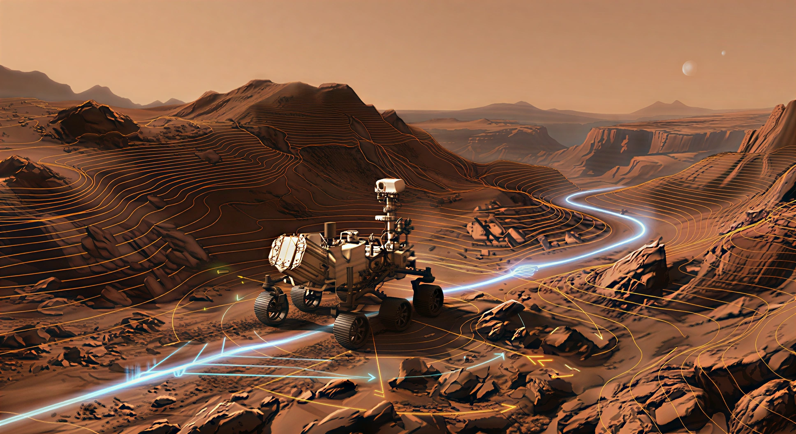

<!-- AI-assisted: written with the help of an AI coding assistant (GitHub Copilot); reviewed by the AutoNav-0 author. -->
# AutoNav-0 Lite



AutoNav is an extended offline-first, open-source take on [NASA Mars Trek](https://trek.nasa.gov/mars/)
that can be deployed on low-power devices for Martian missions. The app's exclusive feature is to plan paths
from point A to point B depending on various requirements such as shortest path, minimal wheel damage and
dead-zone prevention. While there are many advanced sensor-fusion approaches for optimising trajectories,
this project would be one of the open-source ideas developed on NASA's datasets.

Built for the NASA Space Apps Challenge 2026, *Interplanetary Survival Guide: Martian Map*.

## Motivation

Two decades of Mars surface operations have shown that the hard part of moving on Mars is not the distance.
It is everything the map does not tell you. The pain points below are drawn from mission history
([Research.md](Research.md)); each line says how AutoNav addresses it.

1. **Sand traps look like safe, flat ground.** Opportunity spent five weeks digging out of the
   "Purgatory" ripple in 2005 [R1], and Spirit ended its driving career in the soft soil at "Troy" in
   2009 [R2]. Visible imagery and slope maps cannot tell loose fines from firm ground at the same slope.
   → Thermal-inertia "soft ground" costs [D6] and a dune (aeolian bedform) class from the terrain
   classifier make the planner avoid likely sand.
2. **Sharp rocks wear out wheels.** Curiosity's 0.75 mm aluminium wheel skins were punctured and torn
   by wind-carved rocks on otherwise flat plains (sols ~411–490) [R3, R4]. → The *wheel saver* profile
   minimises a wear index (slope load, roughness, rocky ground, turning scrub) and accepts longer routes
   to do so.
3. **Communication dead zones.** Surface assets talk to Earth mostly through relay orbiters, which are
   useful only well above the horizon [R6]. Crater walls, canyon floors and the foot of large mounds hide
   part of the sky and lose passes, and ageing orbiters make relay windows irregular [R5]. Astronauts on
   an EVA cannot afford to drop out of contact. → A **comm dead-spot layer** (on by default) and
   comm-aware route costs, weighted twice as heavily for EVAs.
4. **Position drift forces stop-and-wait.** Wheel slip makes odometry drift; once uncertainty grows past a
   safe margin, the rover halts until it is re-localised against orbital maps [R7, R8]. → Every route
   reports dead-reckoning uncertainty (σ) and inserts re-localisation stops where needed.
5. **Too many trade-offs, no way to compare them.** The shortest route, the gentlest, the one that
   saves the wheels and the fastest walk are rarely the same line. → Google-Maps-style comparison of all
   profiles plus diverse alternatives, with "best for" badges and side-by-side elevation profiles.
6. **Lessons from past drives are not reusable.** Historic traverses sit in separate archives. → 30
   Curiosity, Perseverance and Opportunity routes are layers you can load, re-plan and score with the
   same model ("what did the rover actually drive vs. what would we plan today?").
7. **Mars has no internet.** Browser GIS tools assume connectivity, and Earth is 4–24 light-minutes
   away. → A ~1 MB headless C++ daemon with a cache-first tile store, a small offline data pack and a
   lightweight 2D client that runs on low-power hardware; the 3D view is optional.
8. **The data is scattered.** Elevation, thermal inertia, imagery, nomenclature and traverses live in
   different archives and formats [D1–D9]. → One layered, integrated view with Trek's 165 layers and the
   derived products on top.
9. **Terrain context is missing from the map.** Trek shows pixels, not landforms. → Precomputed terrain
   classes: relief landforms planet-wide and 15 surface-landform classes [D10] for 41 regions,
   including the candidate human Exploration Zones, all fed into the planner.
10. **Light and time matter for EVAs.** → Mars24 local solar time and sun position [A1], with
    hillshade and cast shadows for any sun angle.

AutoNav plans *strategically* from orbital data. It does not replace onboard hazard avoidance; see
[Model assumptions & limits](#model-assumptions--limits).

## Features at a glance

| Area | What you get |
|---|---|
| Trek-style map | 165 NASA Trek WMTS layers, basemaps, bookmarks, IAU feature search, opacity/stacking, rover traverses |
| Terrain analysis | Elevation readout and profiles, slope hazard, contours, sun illumination with cast shadows |
| Route planning | A* profiles: **safe rover**, **wheel saver**, **astronaut EVA**, **shortest**; slope limits, EVA hours, rover sols and energy, wheel-wear index, drift σ and re-localisation stops |
| Route comparison | All profiles plus alternatives, "best for" badges, deltas, overlaid elevation profiles, shareable links |
| Comm dead spots | Default-on layer of relay-coverage loss from terrain masking; dead/poor km per route; adjustable avoidance |
| Terrain classes | Relief landforms (planet-wide) and DoMars16k surface landforms (41 regions); legends, cursor readout, planner costs; GeoTIFF exports |
| Historic routes | Curiosity/Perseverance legs with sol ranges and Opportunity milestones, scored against planned routes |
| 3D view | three.js terrain draped with the current 2D layers, routes in 3D, fly-along |
| Offline / low power | Headless daemon, `--offline`, Unix-socket IPC, systemd unit, Docker image |

```
 ┌──────────── autonav0d (C++17, headless, ~1 MB binary) ─────────────┐
 │ TileCache   offline WMTS cache (+ fill from NASA Trek when online)   │
 │ DemStore    MOLA MEGDR grids in RAM (global 4/16 ppd + 463 m patches)│
 │ Terrain     relief landforms (TPI) + DoMars16k class grids (once)   │
 │ Comms       relay-coverage grids from horizon masking (once)        │
 │ Planner     A* profiles (safe / wheel saver / EVA / shortest),      │
 │             comparison + alternatives, wear, comm & drift telemetry │
 │ Renderer    hillshade + shadows, slope, contours, class maps (PNG)   │
 │ Mars24      Allison & McEwen (2000) Mars time & sun position         │
 └── HTTP on 127.0.0.1:8080  or  Unix domain socket (--unix PATH) ──────┘
        ▲                       ▲
 web/ 2D (Leaflet)      any IPC client (curl, scripts, other tools)
 + 3D (three.js)
```

## Demo: A → B around Mount Sharp, avoiding rough ground and comm dead zones

Start the service, then open
<http://localhost:8080/?from=-4.857,137.7022&to=-5.0883,137.6025&comm_weight=1>. The link places A and B
in Gale crater, east of Aeolis Mons (Mount Sharp), and plans every profile. The direct line runs along the
base of the mountain, where the mound blocks part of the sky.

| Safe-rover route (Gale, 463 m DEM) | Distance | Poor/no comms | Rough ground | Max slope |
|---|---|---|---|---|
| Comm avoidance off (`comm_weight=0`) | 16.9 km | 5.5 km | 2.9 km | 15.5° |
| **Comm avoidance on (`comm_weight=1`)** | 18.9 km | **1.0 km** | **0 km** | 13.2° |
| Astronaut EVA, off → on | 16.2 → 18.1 km | 11.1 → 0.6 km | 2.2 → 1.9 km | 18.2 → 15.3° |

Spending about 2 km more (12 %) keeps the rover in relay coverage for 95 % of the drive and off rough
ground. Any route can be shared the same way: `?from=lat,lon&to=lat,lon[&comm_weight=0|1|3]`.

## Quick start (Ubuntu)

```bash
sudo apt install build-essential cmake libcurl4-openssl-dev python3   # libcurl optional
python3 scripts/fetch_data.py          # small offline pack, only once
cmake -S . -B build && cmake --build build -j
./build/autonav_tests                  # unit tests (Mars24 reference values, DEM, A*, terrain, comms)
./build/autonav0d                      # then open http://127.0.0.1:8080
```

or simply `scripts/run.sh` (build + fetch if needed + run).

Daemon options: `--host`, `--port`, `--unix PATH` (Unix-socket IPC), `--data DIR`, `--web DIR`,
`--upstream URL`, `--offline` (never touch the network) and `--build-relief` (recompute the derived
landform and comm grids). Online/offline can also be toggled at runtime with the 📡 *Uplink* button or
`POST /api/mode?offline=1`. A hardened systemd unit is in `systemd/autonav0d.service`.

### Offline data pack (`scripts/fetch_data.py`)

| Item | Size | Source |
|---|---|---|
| Trek layer catalog (165 tiled layers), 16 bookmarks, 1,783 IAU feature names | ~0.3 MB | NASA Trek index service [D1, D3] |
| MOLA MEGDR global 4 ppd (~15 km/px) and 16 ppd (~3.7 km/px) DEMs | 2 + 33 MB | NASA PDS Geosciences Node [D2] |
| MOLA MEGDR 128 ppd (463 m/px) 3°×3° patches: Jezero, Gale, Gusev, Meridiani | 4 × 288 KB | NASA PDS, via HTTP range reads (no 130 MB downloads) |
| MGS TES thermal inertia, 8 ppd (~7.5 km/px), numeric | 8.3 MB | ASU Mars Global Data Sets [D6] |
| Curiosity & Perseverance traverses + waypoints | ~3 MB | NASA/JPL MMGIS [D4] |
| Historic routes (`catalog/historic_routes.geojson`) | 0.5 MB | derived from MMGIS + IAU names |
| Pre-cached tiles: 5 global layers z0–3 + landing-site tiles z4–7 | ~38 MB | NASA Trek WMTS [D1] |
| Terrain-class layers and classifier heads (`data/terrain/`, in the repo) | ~1.7 MB | this project [D10, A6] |

Options: `--catalog`, `--dem`, `--ti`, `--vectors`, `--tiles`, `--no-dem16` (skip the 33 MB global 16 ppd DEM).
Anything you browse while online is cached under `data/tiles/` and then works offline.

## Docker / Compose

```bash
scripts/stack.sh up            # map service -> http://localhost:8080 (fetches data on first run)
scripts/stack.sh status        # containers + who owns the ports
scripts/stack.sh down          # stop everything
```

`stack.sh` wraps `docker compose` with a preflight: if a port is taken it names the owner instead of
Docker's *"address already in use"* error; use `AUTONAV_PORT=8081 scripts/stack.sh up` to run side by side.
The `autonav0d` image (Ubuntu 24.04, ~100 MB, non-root, health-checked) can bake the data pack in for
stateless deployment: `docker build --build-arg BAKE_DATA=1 -t autonav0d .`.

For a cloud deployment, the service is 12-factor friendly: flags/env configuration, stateless HTTP,
`/api/health` for readiness probes, non-root user. **Before exposing it publicly**, put authentication in
front of it: `POST /api/mode` and `POST /api/rover/state` are unauthenticated by design for local use.

## Comm dead spots (default-on layer)

Relay orbiters (MRO, MAVEN, TGO, Mars Express) are assumed usable above **10° elevation** [R6]. Crater
walls, canyon floors and the foot of big mounds block parts of the sky, so fewer relay passes reach the
ground. For every MOLA cell, `src/comms.cpp` traces the horizon in 16 directions out to 50 km (including
Mars curvature) and rates the cell by the share of directions still open: **open** (not drawn), **reduced**
(≥75 %, yellow), **poor** (40–75 %, orange) or **dead** (<40 %, red). The grids are computed once at first
start (~4 s in total) and cached in `data/terrain/comms/`.

The planner uses the layer. The *safe rover* cost gains `+comm_weight × loss`, and *astronaut EVA* time is
multiplied by `1 + 2 × comm_weight × loss`, because crews must stay in contact. Loss is 0 / 0.25 / 0.6 / 1
for open / reduced / poor / dead. Route cards show km through dead and poor coverage, and the Tools tab has
an *Avoid comm dead spots* setting (off / normal / strong = `comm_weight` 0 / 1 / 3).

## Terrain classes (precomputed layers)

Two hierarchical layers, computed **once** and stored as small categorical grids. The daemon serves them
as tile layers, returns them in `/api/elevation` and feeds them into the planner.

| Layer | Level | Classes | Coverage / resolution | How |
|---|---|---|---|---|
| **Relief landforms** (`/dem/relief`) | 1 (shape) | valley/channel, crater floor/basin, plain, slope/wall, mesa/upland, ridge/crater rim, peak | whole planet at 3.7 km; 463 m at the 4 rover sites | Two-scale Topographic Position Index + slope on MOLA [A5]; built at first start (~2 s) |
| **Surface landforms** (`/dem/terrain`) | group › class | 5 groups (aeolian bedforms, topographic, slope features, impact, basic terrain) › 15 DoMars16k classes | 4 rover sites: 60 km at **250 m**; 37 Trek regional CTX mosaics (the candidate human Exploration Zones): central 100 km at **500 m** | Frozen DINOv2 ViT-B/14 features [A6] + linear head trained on DoMars16k [D10], applied to ~1.2 km windows of Trek CTX mosaics [D7] |

Classifier results on the held-out DoMars16k test split (1,614 images, 15 classes):

| Setting | Test accuracy | Macro-F1 |
|---|---|---|
| ViT-S/14, 1 % of training data (112 images) | 70.8 % | 0.70 |
| ViT-S/14, 10 % | 82.5 % | 0.82 |
| ViT-S/14, 100 % (11,305 images) | 87.5 % | 0.87 |
| ViT-B/14, 100 % | **89.5 %** | 0.89 |
| ViT-B/14 on imagery degraded to Trek z12 (~10 m/px), used for rover sites | 89.0 % | 0.89 |
| ViT-B/14 on imagery degraded to Trek z11 (~20 m/px), used for EZ regions | 86.7 % | 0.86 |

The weakest classes are textured terrain and ridge (F1 ≈ 0.7). An earlier few-shot attempt (sand, bedrock,
rocks and soil labelled from Curiosity's traverse) reached only ~40 % and was dropped.

Each class carries a heuristic **planner effect** (the `planner` table in the grid JSON, editable):
aeolian bedforms are soft (sand-trap risk), cliffs, rough terrain and mass wasting are rocky, and smooth
terrain is benign. Outputs per region: `terrain_<region>_<tier>.json` + `.img` (int16, 0 = no data,
16 = uncertain when p < 0.4) and a GeoTIFF copy (`.tif`, lat/lon on the 3396.19 km sphere) for GIS use.
So far 12 of the 41 regions are mapped (the 4 rover sites and 8 Exploration Zones). Regenerate or resume
with the GPU container (`--skip-existing` is on by default, ~4 min per region on an RTX 5060):

```bash
docker compose -f compose.yaml -f compose.gpu.yaml --profile terrain run --rm terrain-map
docker compose -f compose.yaml -f compose.gpu.yaml --profile terrain run --rm terrain-map --tier sites --regions Gale
# retrain the head: DoMars16k parquet files (HF Mirali33/mb-domars16k) in DIR; needs PyTorch + pyarrow 17
python3 scripts/terrain_train.py --dataset DIR --backbone vitb14 --scale 0.6
```

## Trek feature parity (2D)

| Mars Trek feature | AutoNav-0 Lite |
|---|---|
| Layer browser (mosaics, DEMs, mineralogy, thermal inertia…) with search, opacity, zoom-to | ✅ 165 Trek WMTS layers, filter/in-view, opacity, stacking |
| Basemap switching | ✅ global Trek layers |
| Bookmarks (landing sites, *The Martian* path) that switch on their layers | ✅ |
| Feature-name search & labels (IAU nomenclature) | ✅ |
| Rover traverses / waypoints | ✅ MSL + M2020 (MMGIS), sol popups |
| Elevation readout, profile & distance tool | ✅ cursor elevation, multi-point profile chart |
| Sun angle / lighting | ✅ Mars24 clock, sun az/el sliders, server hillshade **with cast shadows** |
| Slope analysis | ✅ slope hazard overlay (configurable limit), contours |
| Path planning | ➕ four profiles, slope limits, EVA hours, rover sols & energy, wheel-wear index, drift σ and re-localisation stops |
| Comm coverage | ➕ default-on dead-spot layer, comm-aware costs |
| Historic routes | ➕ 30 routes; **Plan** scores the actually-driven path with the same model |
| Route comparison | ➕ all profiles + diverse alternatives, "best for" badges, deltas, shareable links |
| Terrain classification | ➕ relief landforms planet-wide + DoMars16k surface landforms, used by the planner |
| 3D view | ✅ three.js terrain, draped layers, sun-angle shadows, routes in 3D, fly-along |
| Offline use | ➕ cache-first daemon, `--offline`, Unix-socket IPC |
| 3D globe, STL export, KML/shape import | ⏳ roadmap |

## HTTP API (all GET unless noted)

| Endpoint | Purpose |
|---|---|
| `/api/health` | status, online flag, cache counters, loaded grids |
| `POST /api/mode?offline=0\|1` | toggle upstream tile fill (orbiter "uplink") |
| `/api/layers`, `/api/bookmarks`, `/api/nomenclature?q=gale&limit=25` | catalogs |
| `/api/vector/{msl_traverse,msl_waypoints,m20_traverse,m20_waypoints}` | GeoJSON |
| `/api/elevation?lat=&lon=` | best-resolution elevation, thermal inertia, `relief`, `terrain` (group › class) and `comms` class |
| `/api/terrain/classes` | terrain-class and comm-coverage grids: extent, resolution, classes, colours, planner effects |
| `/api/profile?pts=lat,lon;lat,lon[;…]&n=256` | elevation/slope profile |
| `/api/route?from=lat,lon&to=lat,lon&profile=safe\|wear\|eva\|shortest&max_slope=25&drift=0.02&reloc_sigma=50&m_per_sol=150&grid=400&comm_weight=1` | GeoJSON route + telemetry (incl. `comm_dead_km`, `comm_poor_km`) |
| `/api/routes?from=..&to=..&profiles=safe,wear,eva,shortest&alternatives=0..3[&ref=<historic id>]` | route comparison; `ref` adds a historic traverse scored with the same model |
| `/api/historic` | historic rover routes (GeoJSON) |
| `/api/terrain?s=&w=&n=&e=&size=256` | heightmap for the 3D view |
| `GET\|POST\|DELETE /api/rover/state` | live vehicle pose/σ/track pushed by any client |
| `/api/sun?lat=&lon=[&t=unix]` | MSD, Ls, LMST/LTST, sun elevation/azimuth |
| `/tiles/{layer}/{z}/{row}/{col}.{png\|jpg}` | Trek EQ WMTS tile (cache → upstream) |
| `/dem/{hillshade\|slope\|contours}/{z}/{row}/{col}.png?az=&el=&shadows=1&max_slope=&interval=` | DEM-derived rasters |
| `/dem/{relief\|terrain\|comms}/{z}/{row}/{col}.png` | terrain-class and comm dead-spot tiles |

Longitudes are degrees **east, −180…180**; tiles use Trek's equirectangular grid (z0 = 2×1 tiles of 256 px),
which matches Leaflet's `EPSG:4326` scheme.

## Model assumptions & limits

* Elevation is MOLA MEGDR [D2] (463 m/px at sites, 3.7–15 km/px elsewhere). Slopes are smoothed and
  **rocks, ventifacts and sand ripples are invisible**: routes are strategic planning aids, not drive
  commands. Upgrade path: HiRISE/CTX DTMs (1–20 m) as extra `data/dem/*.json+.img` grids.
* Safe-rover cost = 3D distance × (1 + 4·(slope/limit)² + 3·soft + comm loss), with a hard stop above the
  slope limit. EVA cost = walking time from Tobler's hiking function [A3] × 0.5 (suit penalty) × comm
  factor. Shortest = 3D distance with a 45° physical limit. Search is A* [A2] with heading-aware states and penalty-based alternatives.
* **Wheel saver / wear index** (same model for every route, so comparisons are fair): per edge,
  3D distance × (1 + 2·(slope/limit)² + 3·roughness + 2·rocky + 0.5·soft), plus 0.6 cell-lengths per 45° of
  heading change (turning scrub). Roughness = detrended DEM curvature; *rocky* = TES thermal inertia
  300→500 or a rocky terrain class; *soft* = TI 150→50 or a dune class [D6, R1–R4]. TES is 7.5 km/px: it
  flags *regional* rockiness, not individual rocks.
* Rover energy: MSL-class 1,025 kg, rolling resistance 0.15, 25 % drivetrain efficiency, g = 3.721 m/s².
* Odometry drift σ = drift % × distance since the last fix; a re-localisation stop is inserted when σ
  exceeds the threshold [R7, R8].
* Comm coverage is geometry only, not a link budget: it ignores orbit timing, direct-to-Earth geometry,
  dust and antenna patterns, and the 10° mask is an assumption. Narrow gullies and small craters are below
  MOLA resolution.
* Terrain classes describe ~1.2 km windows: narrower features (e.g. the ~1 km-wide Bagnold dune band at
  Gale) are often labelled by their surroundings. They are orbital morphology, not ground truth.
* Historic comparisons resample the driven path onto the planning grid, so its distance is a little shorter
  than logged odometry. Opportunity routes are milestones only (straight segments between endpoints).

## References

Licence details for every dataset and library are in [CITATIONS.md](CITATIONS.md).

**Mission experience and background**

* [R1] NASA/JPL (2005). Opportunity frees itself from the "Purgatory" ripple, Meridiani Planum (sol 446 embedding, freed after ~5 weeks). Mars Exploration Rover mission news.
* [R2] Arvidson, R. E. et al. (2010). Spirit Mars Rover Mission: overview and selected results from the northern Home Plate Winter Haven to the side of Scamander crater. *J. Geophys. Res.* 115, E00F03.
* [R3] Arvidson, R. E. et al. (2017). Relating geologic units and mobility system kinematics contributing to Curiosity wheel damage at Gale Crater, Mars. *J. Terramechanics* 73, 73–93.
* [R4] NASA Lessons Learned Information System. *Premature Wear of the MSL Wheels.*
* [R5] NASA/JPL Robotics. *Next-Gen AutoNav Concept* (autonomous navigation beyond line of sight). <https://www-robotics.jpl.nasa.gov/what-we-do/research-tasks/next-gen-autonav-concept/>
* [R6] Edwards, C. D. Jr. (2007). Relay communications for Mars exploration. *Int. J. Satellite Communications and Networking* 25(2), 111–145.
* [R7] Maimone, M., Cheng, Y. & Matthies, L. (2007). Two years of visual odometry on the Mars Exploration Rovers. *J. Field Robotics* 24(3), 169–186.
* [R8] Verma, V. et al. (2023). Autonomous robotics is driving Perseverance rover's progress on Mars. *Science Robotics* 8(80).
* [R9] NASA Space Apps Challenge 2026. *Interplanetary Survival Guide: Martian Map.* <https://www.spaceappschallenge.org/2026/challenges/interplanetary-survival-guide-martian-map/>

**Data**

* [D1] NASA Solar System Treks (JPL-Caltech). Mars Trek WMTS tiles and layer/bookmark/nomenclature index. <https://trek.nasa.gov/mars/>
* [D2] Smith, D. E. et al. (2003). MGS MOLA Mission Experiment Gridded Data Records (MEGDR), MGS-M-MOLA-5-MEGDR-L3-V1.0. NASA PDS Geosciences Node.
* [D3] IAU WGPSN / USGS Astrogeology. Gazetteer of Planetary Nomenclature.
* [D4] NASA/JPL-Caltech MMGIS. Mars Science Laboratory and Mars 2020 traverses and waypoints.
* [D5] USGS Astrogeology / NASA. Viking MDIM 2.1 global colour mosaic.
* [D6] Christensen, P. R. et al. (2001). Mars Global Surveyor Thermal Emission Spectrometer experiment. *J. Geophys. Res.* 106(E10), 23823–23871; TES thermal inertia via ASU Mars Global Data Sets; Putzig, N. E. & Mellon, M. T. (2007), *Icarus* 191, 68–94.
* [D7] Malin, M. C. et al. (2007). Context Camera investigation on board the Mars Reconnaissance Orbiter. *J. Geophys. Res.* 112, E05S04 (CTX mosaics via Trek).
* [D8] McEwen, A. S. et al. (2007). Mars Reconnaissance Orbiter's High Resolution Imaging Science Experiment (HiRISE). *J. Geophys. Res.* 112, E05S02.
* [D9] Edwards, C. S. et al. (2011). Mosaicking of global planetary image datasets: THEMIS day and night infrared. *J. Geophys. Res.* 116, E10008.
* [D10] Wilhelm, T. et al. (2020). DoMars16k: a diverse dataset for weakly supervised geomorphologic analysis on Mars. *Remote Sensing* 12(23), 3981. doi:10.3390/rs12233981; data doi:10.5281/zenodo.4291940 (CC BY 4.0), used via HF `Mirali33/mb-domars16k`.
* HRSC-derived Trek layers: ESA/DLR/FU Berlin, CC BY-SA 3.0 IGO (optional overlays, not prefetched).

**Algorithms and models**

* [A1] Allison, M. & McEwen, M. (2000). A post-Pathfinder evaluation of areocentric solar coordinates with improved timing recipes for Mars seasonal/diurnal climate studies. *Planet. Space Sci.* 48, 215–235; NASA GISS Mars24 algorithm notes.
* [A2] Hart, P. E., Nilsson, N. J. & Raphael, B. (1968). A formal basis for the heuristic determination of minimum cost paths. *IEEE Trans. SSC* 4(2), 100–107.
* [A3] Tobler, W. (1993). *Three presentations on geographical analysis and modeling* (hiking function).
* [A5] Weiss, A. (2001). *Topographic Position and Landforms Analysis*, ESRI User Conference; Jenness, J. (2006). *Topographic Position Index*.
* [A6] Oquab, M. et al. (2023). DINOv2: Learning robust visual features without supervision. arXiv:2304.07193 (TMLR 2024). Code and weights Apache-2.0.

**Software**: cpp-httplib (MIT), nlohmann/json (MIT), stb_image_write (MIT/PD), Leaflet (BSD-2-Clause),
three.js (MIT), libcurl (curl licence), PyTorch/torchvision (BSD-3-Clause), Apache Arrow `pyarrow`
(Apache-2.0).

## Licensing

Source code: choose a licence for the repo (MIT or Apache-2.0 recommended; all bundled third-party code is
permissive). Derived terrain-class grids keep the CC BY 4.0 attribution to DoMars16k and the NASA/JPL/MSSS
credit. Parts of this code were written with an AI coding assistant (GitHub Copilot); see the
`AI-assisted` header in each file.
